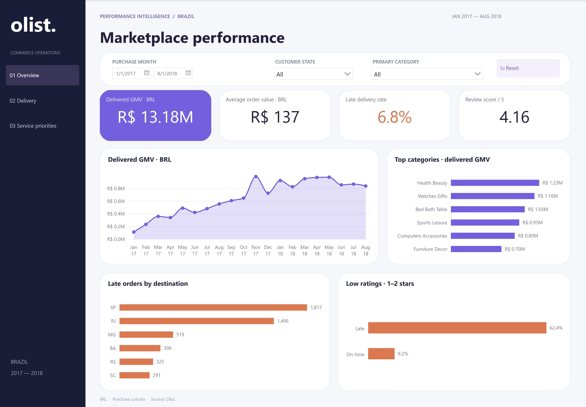

# Olist Marketplace Operations Analytics

**SQL · Python · Power BI · DAX**

An operating view of marketplace growth, delivery reliability and customer experience using 99,441 real anonymized source orders. Reporting purchases cover Jan 2017–Aug 2018: 99,092 orders, 96,211 delivered orders and 96,203 eligible delivery outcomes.



## Report pages

- **Marketplace overview:** delivered GMV, average order value, delivery reliability, review score, category mix and destination exceptions.
- **Delivery operations:** destination exposure, monthly late-rate trend and a seller exception queue.
- **Service priorities:** destination/category exposure, delivery-duration distribution and an adjustable late-delivery reduction scenario.
- **Seller detail:** hidden native drillthrough page for seller investigation.

[Download the Power BI report](powerbi/Olist-Marketplace-Intelligence.pbix) · [Editable project](powerbi/Olist.pbip) · [Browser dashboard](dashboard/OPEN_DASHBOARD.html)

## Findings and decisions

- R$13,181,027.13 delivered GMV; 6,531 late deliveries, or 6.8% of eligible deliveries.
- Rio de Janeiro: 1,495 late deliveries and 12.1% late rate. Investigate route handoffs and promise lead times alongside exception volume.
- Reviewed late deliveries have a 62.4% low-rating rate versus 9.2% on-time. This supports testing customer communication; the association does not prove causal impact.
- The planning scenario assumes unchanged order volume. A 20% relative reduction implies 1,306 potentially avoided late deliveries; this is an assumption, not a forecast.

[Detailed findings](analysis/docs/FINDINGS.md) · [Metric definitions](analysis/docs/METRIC_CONTRACT.md) · [SQL marts](analysis/sql/01_order_mart.sql) · [Business queries](analysis/sql/02_business_analysis.sql) · [Executed notebook](analysis/notebooks/marketplace_analysis.ipynb)

## Model and validation

Eight native Power BI tables, four dimension relationships and 44 DAX measures. Child records are aggregated before joining orders to prevent fanout. The seller queue uses single-seller orders and at least 100 eligible deliveries in the selected context. [DAX definitions](powerbi/DAX_MEASURES.md), [native checks](powerbi/native-metric-verification.json), [data-quality audit](analysis/docs/DATA_QUALITY.html).

Delivered GMV excludes freight and is not marketplace revenue or profit. Whole-order category assignment uses the largest merchandise-value category. Source outcome records are eventual outcomes, not point-in-time forecasts.

## Reproduce

From `analysis/`:

```powershell
python -m venv .venv
.venv/Scripts/python.exe -m pip install -r requirements.txt
.venv/Scripts/python.exe src/build_project.py
.venv/Scripts/python.exe src/verify_project.py
```

The pipeline downloads the public Olist dataset and creates the local SQLite marts and processed exports. Then, from `powerbi/`, run the same environment's Python with `src/build_native.py`. It rebuilds the semantic snapshot and restores the reviewed business report template. Open `Olist.pbip` in Desktop, process/refresh the calculated tables, then save a PBIX. On macOS/Linux use `.venv/bin/python` for the analytical pipeline; Power BI Desktop requires Windows.

The delivered PBIX embeds historical native calculated-table snapshots. Refresh recalculates that snapshot; it does not fetch new transactions. See [attribution](powerbi/ATTRIBUTION.md) for CC BY-NC-SA 4.0 terms. This is an independent public-data project, not Olist employment or consulting work.

## Repository

Suggested GitHub name: **olist-marketplace-operations-analytics**.

Description: **SQL, Python and Power BI analysis of 99K marketplace orders, delivery reliability, seller exceptions and customer experience.**

See [upload instructions](UPLOAD-TO-GITHUB.md) and [CV wording](CV-BULLETS.md).
