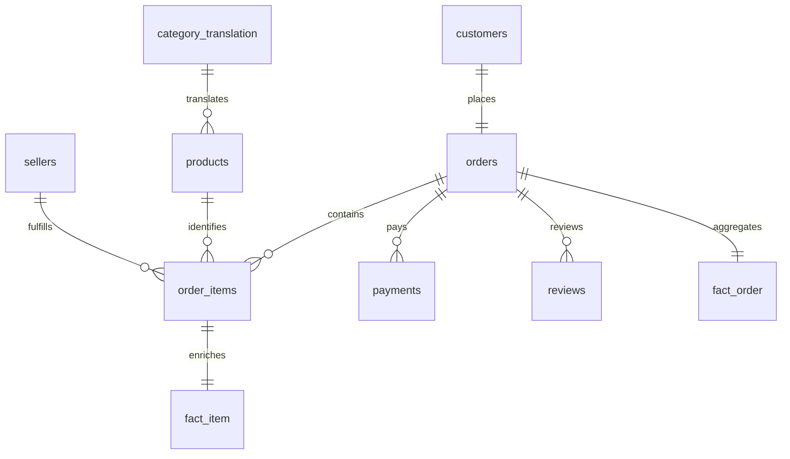

# Metric contract and model

Reporting unit is an order; currency is original BRL, without inflation adjustment or currency conversion. Raw timestamps have no timezone metadata; preserve source local clock values. Delivery SLA uses calendar dates to avoid classifying delivery on the promised day as late.

| Metric | Numerator / value | Denominator / population |
|---|---|---|
| Orders | Count fact_order | All statuses in selected purchase window |
| Delivered GMV | Sum item price | Delivered status only; freight excluded |
| Delivered AOV | Delivered GMV | Delivered order count |
| Late rate | Actual delivery calendar date > estimated calendar date | Delivered status with both dates known |
| On-time rate | 1 − late rate | Same eligibility |
| Average review | Latest review score per order | Reviewed eligible delivered orders |
| Low-rating rate | Review score in {1,2} | Reviewed eligible delivered orders, split late/on-time |
| Median delivery days | Median elapsed seconds / 86400 from purchase to actual delivery | Eligible delivered orders |
| Freight ratio | Delivered freight sum | Delivered item-price sum; buyer freight burden, not operating cost |
| Growth benchmark | Jan–Aug 2018 GMV / Jan–Aug 2017 GMV − 1 | Fixed full-market, delivered orders |
| 90-day repeat | Customers with a subsequent delivered purchase in (0,90] elapsed days | Eligible first-observed delivered buyers, Jan 2017–Jun 2 2018 |
| Seller late rate | Late orders associated with seller | Eligible single-seller orders; queue requires >=100 in view |
| Scenario avoided late orders | Current late orders × assumed relative reduction | Volume held constant; no causal or financial claim |

Primary category assigns all order GMV to the category contributing most item price. Ties break alphabetically. This is a whole-order segmentation, not a product-level sales report. Use `fact_item.category` for actual item category sales, and never sum whole-order GMV over item joins.

## Grains and relationships

Raw customers use per-order `customer_id`. Cross-order identity is `customer_unique_id`; it must be used for repeat analysis. `fact_order` has 99,441 unique rows across the full snapshot. `fact_item` has 112,650 rows at `(order_id, order_item_id)` grain. Geolocation has repeated ZIP prefixes and is profiled but not joined; raw ZIP joins would multiply records. All nine source tables are retained in SQLite.

## Deduplication and missingness

Reviews contain 551 additional rows beyond unique order keys. Keep the latest `review_answer_timestamp`, breaking ties by `review_creation_date` then `review_id`. Ratings are 1–5. Preserve orders without items, assign 0 merchandise/freight; those are largely unfinished statuses. Missing classifications become `unclassified`. Missing actual delivery dates do not imply on time. Full null profiles and integrity exceptions are in quality_report.json and the human-readable quality report.

## Temporal validation

Training uses eligible order outcomes already delivered before July 1, 2018. The state × category rate is smoothed with 50 pseudo-observations at the training base rate. Test population is eligible delivered purchases in July–August 2018; outcome records are eventual. Flag scores in the top quintile of the test score distribution (ties can increase coverage), without using test labels to select the threshold. This evaluates ranking, not calibration or a production threshold policy.

The rule fails to lift late-order concentration in the holdout. The training sample excludes outcomes not yet observed by cutoff, which can bias toward faster deliveries near the boundary. Further work needs an outcome-maturation embargo, rolling temporal splits and carrier/dispatch features. No production warning model is claimed.
